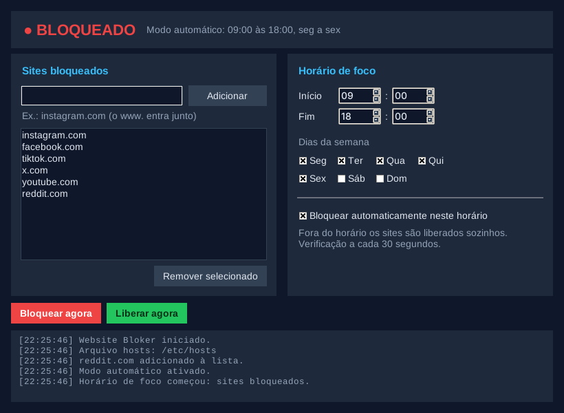

# Website Bloker

Bloqueador de sites que tiram o foco (redes sociais, vídeos, etc.) durante o horário de estudo ou trabalho. Tem interface gráfica, funciona no **Windows, Linux e macOS** e não precisa instalar nenhuma biblioteca: só Python.



## Funcionalidades

- **Lista de sites** editável: digite `instagram.com` ou cole um link inteiro (`https://www.instagram.com/explore`), que o programa limpa o endereço. A versão com `www.` é bloqueada junto.
- **Bloquear / Liberar agora** com um clique.
- **Modo automático por horário**: escolha início, fim e dias da semana. Dentro do horário os sites são bloqueados e fora dele são liberados sozinhos. Horários que passam da meia-noite (ex.: 22:00 às 06:00) também funcionam.
- **Seguro para o arquivo hosts**: o programa só mexe no bloco que ele mesmo criou, entre dois marcadores. As linhas que já estavam no arquivo nunca são apagadas, e uma cópia do original é guardada em `hosts.website_bloker.bak` na primeira alteração.
- Limpa o cache de DNS do sistema após cada mudança, para o bloqueio valer na hora.
- As preferências ficam salvas em `~/.website_bloker.json` e voltam na próxima vez que o programa abrir.
- Ao fechar com os sites bloqueados, o programa pergunta se o bloqueio deve continuar.

## Como funciona

Todo sistema operacional tem um arquivo **hosts**, consultado antes do DNS. O Website Bloker adiciona nele linhas como:

```
# >>> Website_Bloker: inicio (nao edite este bloco)
127.0.0.1 instagram.com
127.0.0.1 www.instagram.com
# <<< Website_Bloker: fim
```

Assim o endereço do site passa a apontar para o próprio computador (`127.0.0.1`) e a página não carrega. Para liberar, o bloco é removido.

| Sistema | Arquivo hosts |
|---|---|
| Windows | `C:\Windows\System32\drivers\etc\hosts` |
| Linux / macOS | `/etc/hosts` |

## Requisitos

- Python 3.9 ou mais novo, com Tkinter (já vem no instalador oficial do Windows e do macOS).
  - No Ubuntu/Debian, se faltar: `sudo apt install python3-tk`
- Permissão de administrador, porque o arquivo hosts é protegido pelo sistema.

## Como usar

```bash
git clone https://github.com/thi-araujo/Website_Bloker.git
cd Website_Bloker
```

**Windows:** abra o Prompt de Comando ou o PowerShell **como administrador** e rode:

```bash
python website_bloker.py
```

Se abrir sem permissão, aparece uma faixa amarela com o botão **Reabrir como administrador**.

**Linux / macOS:**

```bash
sudo python3 website_bloker.py
```

> **Dica:** se um site bloqueado ainda abrir, feche e abra o navegador. Navegadores guardam endereços em cache e alguns usam "DNS seguro" (DNS over HTTPS), que ignora o arquivo hosts. No Chrome/Edge, desative em *Configurações > Privacidade e segurança > Usar DNS seguro*; no Firefox, em *Configurações > Privacidade > DNS via HTTPS*.

## Estrutura do projeto

```
Website_Bloker/
├── website_bloker.py      # interface gráfica (Tkinter)
├── bloqueador.py          # lógica: arquivo hosts, horários e configuração
├── tests/
│   └── test_bloqueador.py # testes automatizados
└── docs/
    └── tela.png           # captura de tela usada neste README
```

A lógica fica separada da interface, então `bloqueador.py` pode ser usado sozinho:

```python
import bloqueador

bloqueador.aplicar_bloqueio(["instagram.com", "youtube.com"])
bloqueador.remover_bloqueio()
```

## Testes

Os testes usam um arquivo hosts temporário, então não mexem no sistema nem precisam de administrador:

```bash
python -m unittest discover -s tests -v
```

Para testar a interface sem alterar o hosts de verdade, aponte o programa para outro arquivo com a variável `WEBSITE_BLOKER_HOSTS`:

```bash
echo "127.0.0.1 localhost" > hosts_teste
WEBSITE_BLOKER_HOSTS=hosts_teste python3 website_bloker.py
```

## Histórico

Este foi meu primeiro mini-projeto em Python (maio de 2022): um script de terminal que bloqueava o Instagram das 9h às 22h, só no Linux. Em 2026 ele foi refeito com interface gráfica, suporte a Windows/macOS, edição segura do arquivo hosts, configuração salva e testes.

## Autor

**Thiago Gomes Araújo**: [GitHub](https://github.com/thi-araujo) · [Portfólio](https://thi-araujo.github.io)
